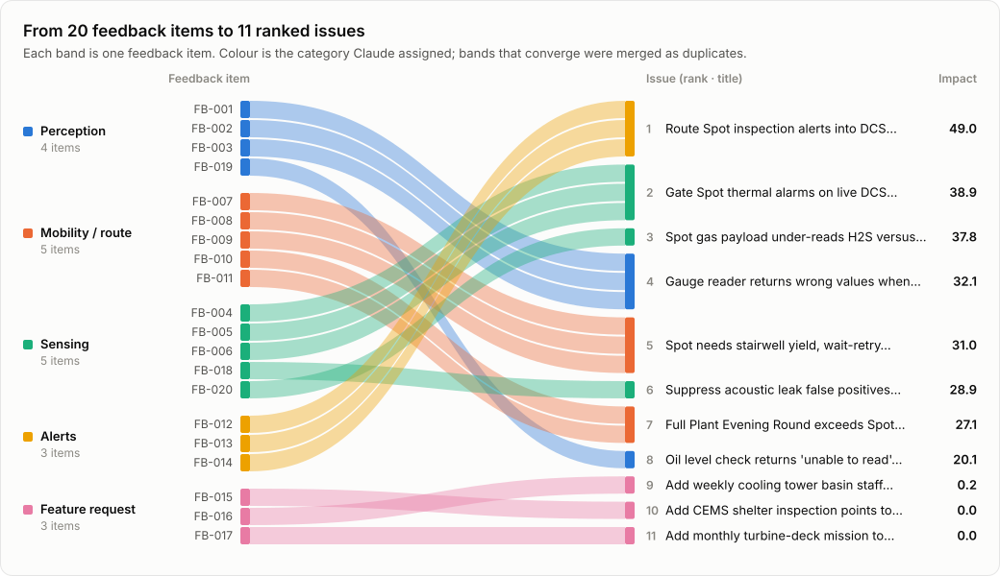
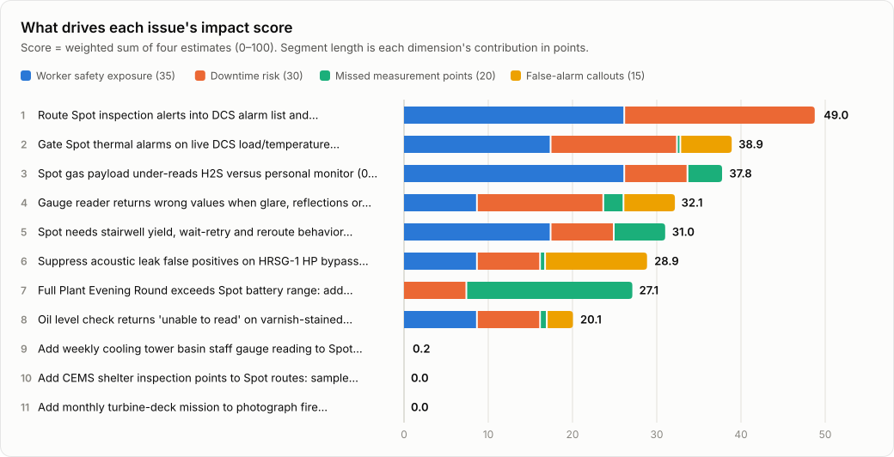
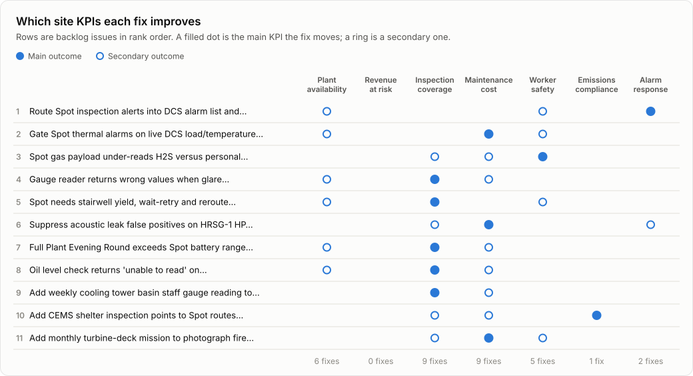

# Example backlog

[← Back to README](../README.md)

From a real run of `python agent.py` (claude-opus-5-5, effort medium) on the 20 items in `data/feedback.json`. The merge step grouped them into 11 issues, matching the intended duplicate groups. Results vary a little between runs; the full output, with every ticket, is `output/backlog.md`.

| Rank | Issue | Category | Priority | Impact | Missed pts/wk | Downtime risk | False callouts/mo | Safety exposure | Reports |
|---:|---|---|:-:|---:|---:|:-:|---:|:-:|---|
| 1 | Route Spot inspection alerts into DCS alarm list and operator handhelds with acknowledgement and escalation | alerts | P1 | **49.0** | 1 | 4/5 | 0 | 4/5 | FB-012, FB-013, FB-014 |
| 2 | Gate Spot thermal alarms on live DCS load/temperature context and fix emissivity/reflection errors before paging on-call staff | sensing | P1 | **38.9** | 2 | 3/5 | 4 | 3/5 | FB-004, FB-005, FB-006 |
| 3 | Spot gas payload under-reads H2S versus personal monitor (0 ppm vs 6 ppm); add bump-test/calibration tracking and enforcement | sensing | P1 | **37.8** | 20 | 2/5 | 0 | 4/5 | FB-020 |
| 4 | Gauge reader returns wrong values when glare, reflections or floodlight washout obscure gauge faces (LG-2101, PI-204, GT-1 lube oil) | perception | P1 | **32.1** | 12 | 3/5 | 4 | 2/5 | FB-001, FB-002, FB-003 |
| 5 | Spot needs stairwell yield, wait-retry and reroute behavior, plus immediate abort notification, when people are on stairs | mobility_route | P1 | **31.0** | 30 | 2/5 | 0 | 3/5 | FB-007, FB-008, FB-009 |
| 6 | Suppress acoustic leak false positives on HRSG-1 HP bypass valve using DCS valve position context | sensing | P1 | **28.9** | 3 | 2/5 | 8 | 2/5 | FB-018 |
| 7 | Full Plant Evening Round exceeds Spot battery range: add mission split or mid-route dock-recharge-and-resume | mobility_route | P2 | **27.1** | 98 | 2/5 | 0 | 1/5 | FB-010, FB-011 |
| 8 | Oil level check returns 'unable to read' on varnish-stained GT-1 lube oil sight glass; add dirty-glass handling and a 'glass needs cleaning' result | perception | P2 | **20.1** | 4 | 2/5 | 2 | 2/5 | FB-019 |
| 9 | Add weekly cooling tower basin staff gauge reading to Spot inspection missions | feature_request | P3 | **0.2** | 1 | 1/5 | 0 | 1/5 | FB-016 |
| 10 | Add CEMS shelter inspection points to Spot routes: sample line heater temperature, NOx analyzer status lights, cal gas bottle pressures | feature_request | P3 | **0.0** | 0 | 1/5 | 0 | 1/5 | FB-015 |
| 11 | Add monthly turbine-deck mission to photograph fire extinguisher pressure gauges and inspection tags | feature_request | P3 | **0.0** | 0 | 1/5 | 0 | 1/5 | FB-017 |

## Business outcomes

Which fixes move which site KPI (numbers are ranks from the table above).

| Site KPI | Improved by |
|---|---|
| Plant availability (unplanned downtime, forced outages, derates) | 1, 2, 4, 5, 7, 8 |
| Inspection coverage (share of planned readings captured and usable) | 3, 4, 5, 6, 7, 8, 9, 10, 11 |
| Maintenance and callout cost (overtime, unnecessary dispatches, manual rounds) | 2, 3, 4, 6, 7, 8, 9, 10, 11 |
| Worker exposure in hazardous areas (gas, HV, stairs, hot work) | 1, 2, 3, 5, 11 |
| Environmental compliance (CEMS data availability, permit reporting) | 10 |
| Alarm response time (time from detection to acknowledgement) | 1, 6 |

## The top-ranked ticket in full

### 1. Route Spot inspection alerts into DCS alarm list and operator handhelds with acknowledgement and escalation

**Category:** alerts · **Priority:** P1 · **Impact score:** 49.0 · **Reports:** FB-012, FB-013, FB-014

**Problem.** Spot alerts are delivered only by email and the Spot web dashboard, which no one monitors on nights or weekends. Operators on nights work from the DCS, radios and handhelds. Two alerts went unseen for hours. FB-012: an elevated H2 alert at the generator seal oil unit was raised at 03:12 and stayed unacknowledged until day shift opened it at 07:05, about 4 hours. The cause was a minor fitting leak. FB-014: a low oil level alert on the BFP-B outboard bearing was raised Saturday at 22:40 and not seen until Monday morning, about 1.5 days of lost reaction time on a boiler feed pump. The bearing was fine and was topped up. FB-013 confirms that night-shift field operators never see robot alerts in their normal workflow.

**Likely cause.** This is an integration gap rather than a detection failure. The robot detected both conditions correctly. The likely cause is that the Spot alerting pipeline has no interface to the plant DCS alarm system (for example OPC UA/Modbus alarm tags or an alarm server feed) and no mobile push channel to operator handhelds. Hypothesis: there is also no acknowledgement tracking or escalation logic, so an unread alert never reaches anyone else.

**Proposed feature.** Build an alert integration service that publishes robot alerts with severity, asset tag, location, reading value and a snapshot link. It should write to two channels: DCS alarm tags, via OPC UA or a protocol agreed with I&C, so alerts appear in the operator alarm list, and push notifications to operator handhelds. Each alert should have a severity-based acknowledgement timer. If an alert is not acknowledged, it escalates in turn to the shift supervisor, then the control room, then on-call maintenance. Gas alerts (H2, H2S, CH4) should be mapped to the highest priority with the shortest escalation timeout. Acknowledgements should sync between the DCS, the handheld and the dashboard, and every alert should keep an audit trail of time-to-acknowledge.

**Acceptance criteria**

- A simulated robot H2 alert appears in the DCS operator alarm list and on the on-shift operator handhelds within 60 seconds of detection.
- If a high-priority gas alert is not acknowledged within the configured timeout (default 10 minutes), it escalates automatically to the shift supervisor, and then to the next escalation tier if still unacknowledged.
- Acknowledging an alert on any channel (DCS, handheld or web dashboard) marks it acknowledged on all channels within 30 seconds and records who acknowledged it and when.
- Time-to-acknowledge is logged for every alert and is reportable per shift, so a 4-hour gap like FB-012 would be visible.

**Business outcomes if fixed**

- **Alarm response time:** Time to acknowledge robot alerts drops from the reported 4 hours (H2) and about 1.5 days (BFP-B oil) to minutes through DCS and handheld delivery with escalation.
- **Worker exposure in hazardous areas:** Gas leaks such as the generator seal oil H2 leak are acted on within minutes instead of persisting for hours while staff may be working nearby.
- **Plant availability:** About 1 critical alert per week that currently goes unseen (for example generator seal oil H2 or BFP bearing oil) is acted on promptly, cutting the risk that a developing fault leads to a GT train trip or feed pump derate.

**Impact rationale.** The readings are being captured; what fails is that alerts go unseen. Over roughly 3 weeks of reports there were 2 unacknowledged alerts, so about 1 actionable reading per week is effectively lost. Downtime risk is high. A slow-developing generator H2 seal leak or a BFP bearing oil loss, if unseen for hours to days, could cause a forced trip or derate. A generator or GT train trip removes roughly half the plant's ~750 MW, and losing a BFP forces a derate. No false callouts are reported. Safety exposure is high because an H2 leak near the generator went unattended for about 4 hours, with explosion risk to anyone working nearby.
